# AI Shop

[简体中文](README.md) | **English**

Website: [https://5aishop.com](https://5aishop.com)

A self-hosted digital goods storefront with product listings, self-service purchases, automatic delivery, protected order lookup, and an administration dashboard. Built with Next.js, TypeScript, PostgreSQL, Prisma, and Redis, with responsive layouts for desktop and mobile.

## WeChat community

Discuss deployment, usage, and feature ideas. Scan the QR code or open the [join page](https://5aishop.com/community), then use WeChat to recognize the latest group QR code on that page. The community page is currently in Simplified Chinese.

<a href="https://5aishop.com/community"></a>

This QR code points to a permanent page. Administrators update the group QR code once for both the storefront and README entry. The underlying WeChat group code still needs replacement when it expires or the group fills up.

## Preview

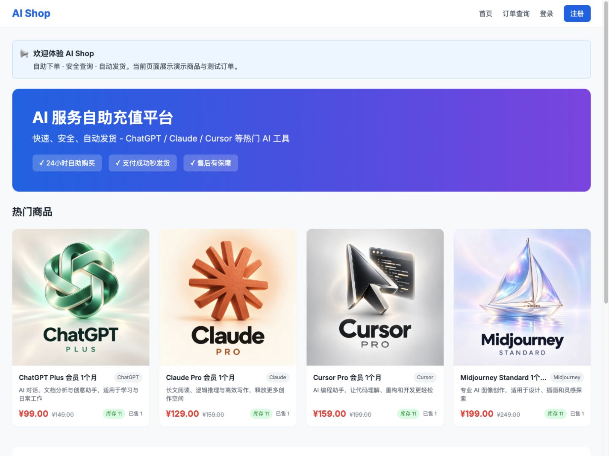

From customer purchases to store operations: products, memberships, account balances, orders, digital keys, and settings. These screenshots use an isolated demo environment with synthetic accounts, orders, amounts, and digital keys. The current interface and the shared video captions are in Simplified Chinese.

Screenshots and video were captured on 2026-10-04. They predate the separate Support & community page, unsold-key management, and persistent admin sidebar. Use the current feature and configuration descriptions below for those additions.

[Download the 86-second feature tour (1080p MP4)](docs/showcase/ai-shop-feature-tour.mp4) · [Browse all 19 screenshots](docs/showcase/README.md)

https://github.com/user-attachments/assets/5f4e285b-39c4-4d1d-bfe6-f762d8f530ca

The tour combines real page screenshots, captions, and transitions; it is not a continuous screen recording. The demo completed a purchase using a test account balance and delivered a test key. No external payments, email, or Telegram notifications were sent during capture.

<details>
<summary>Customer features: purchases, order lookup, delivery, memberships, and balances</summary>

### Product details and direct purchase

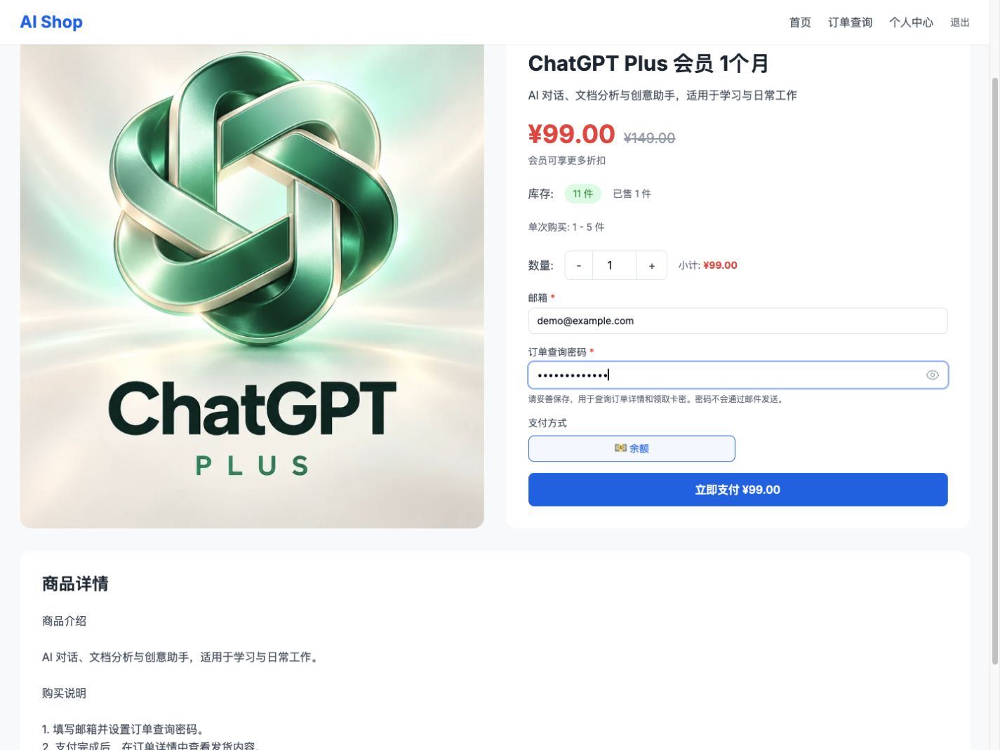

### Order lookup and verification

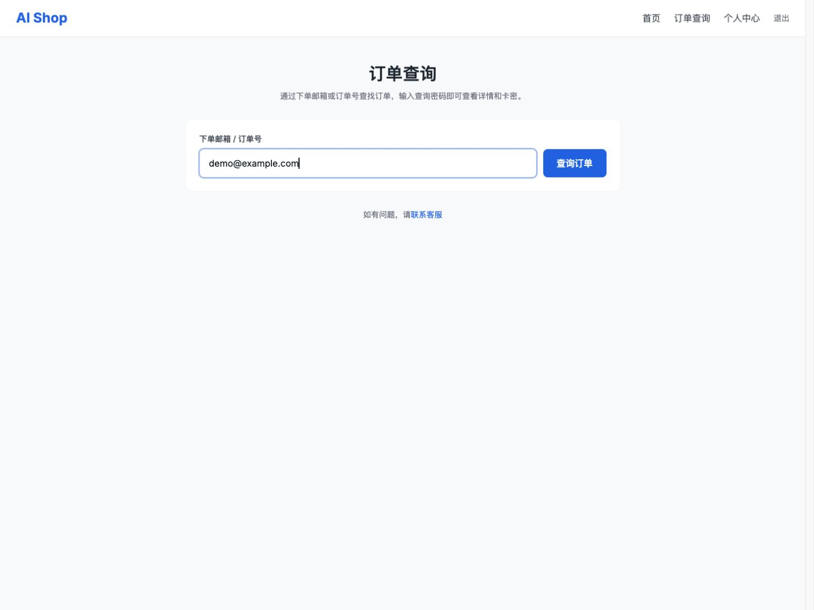

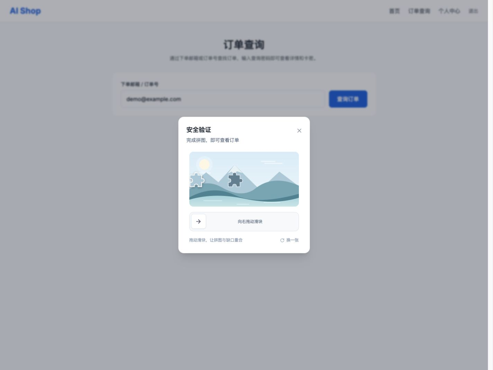

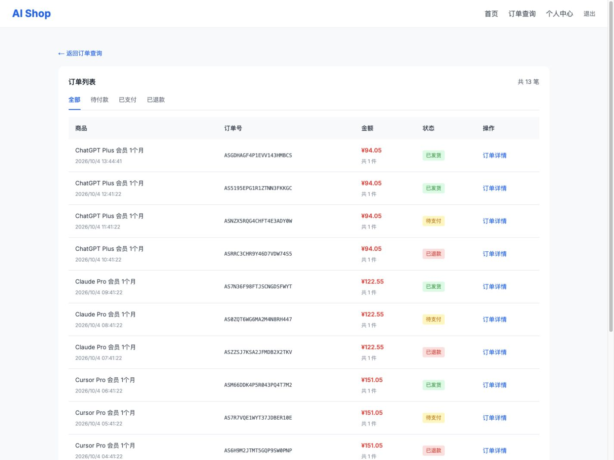

### Automatic delivery and digital keys

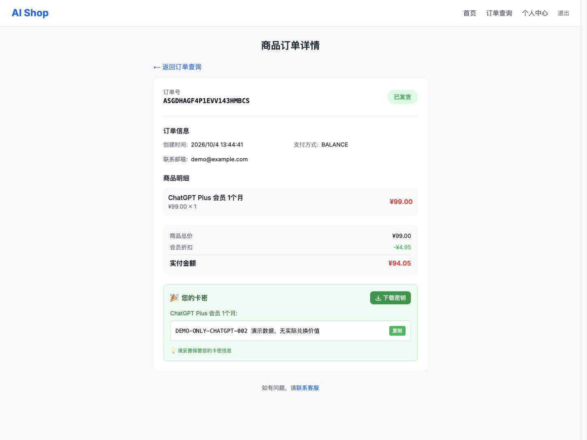

### Member center and balance history

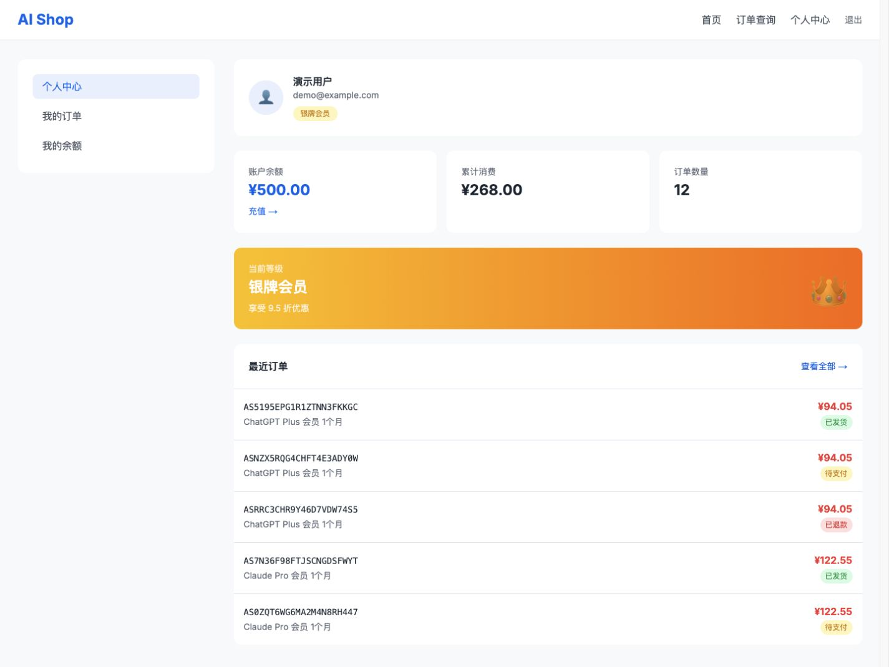

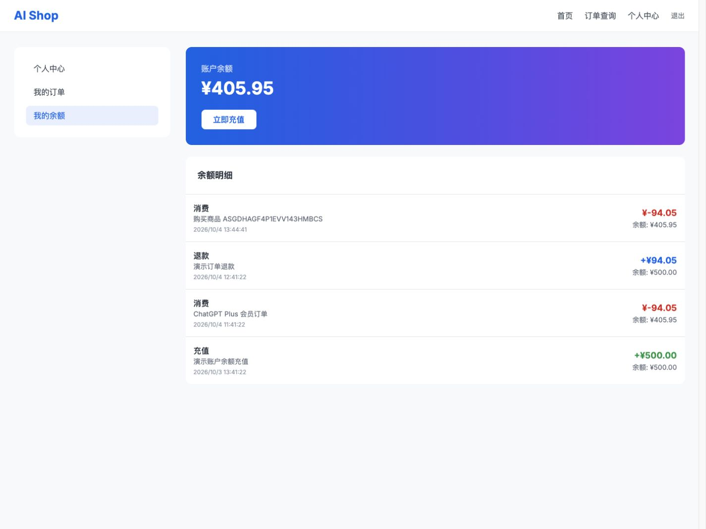

</details>

<details>
<summary>Administration: statistics, products, orders, digital keys, and settings</summary>

### Operations dashboard

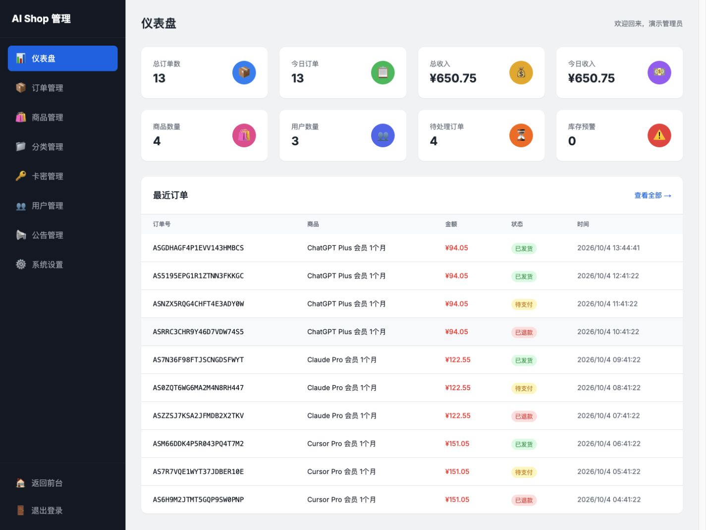

### Products and digital key inventory

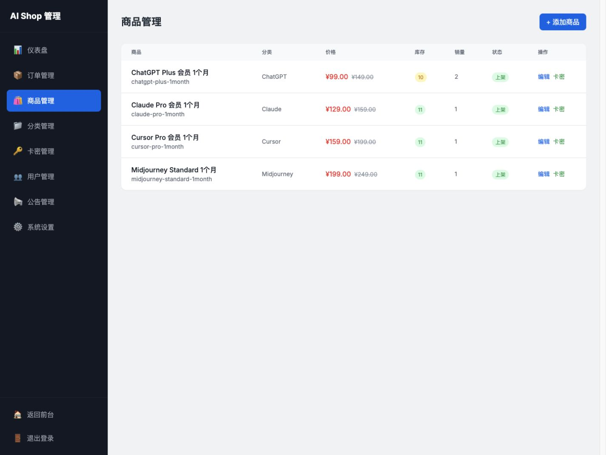

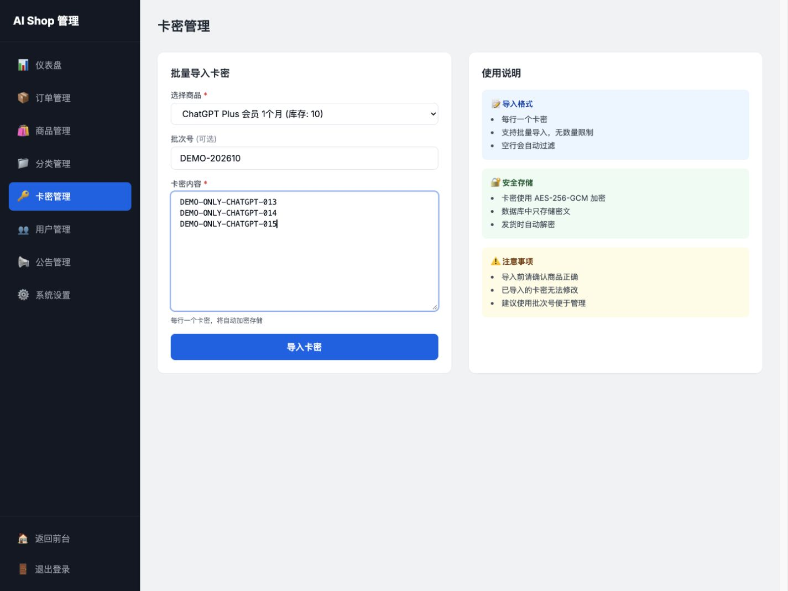

### Orders and settings

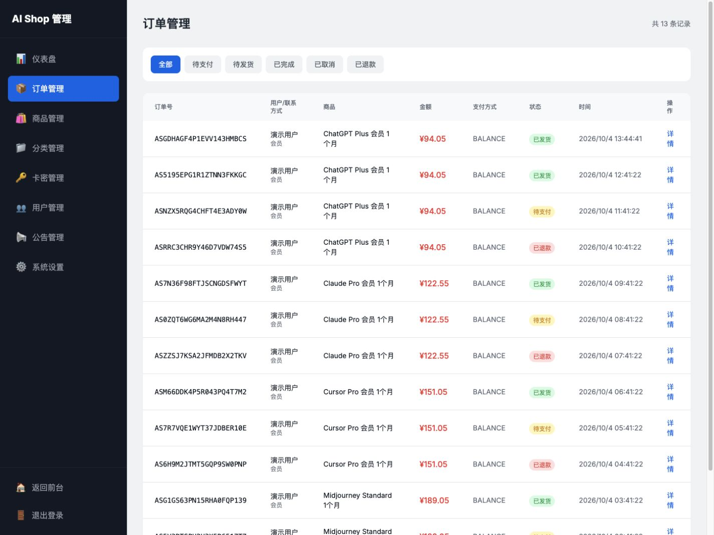

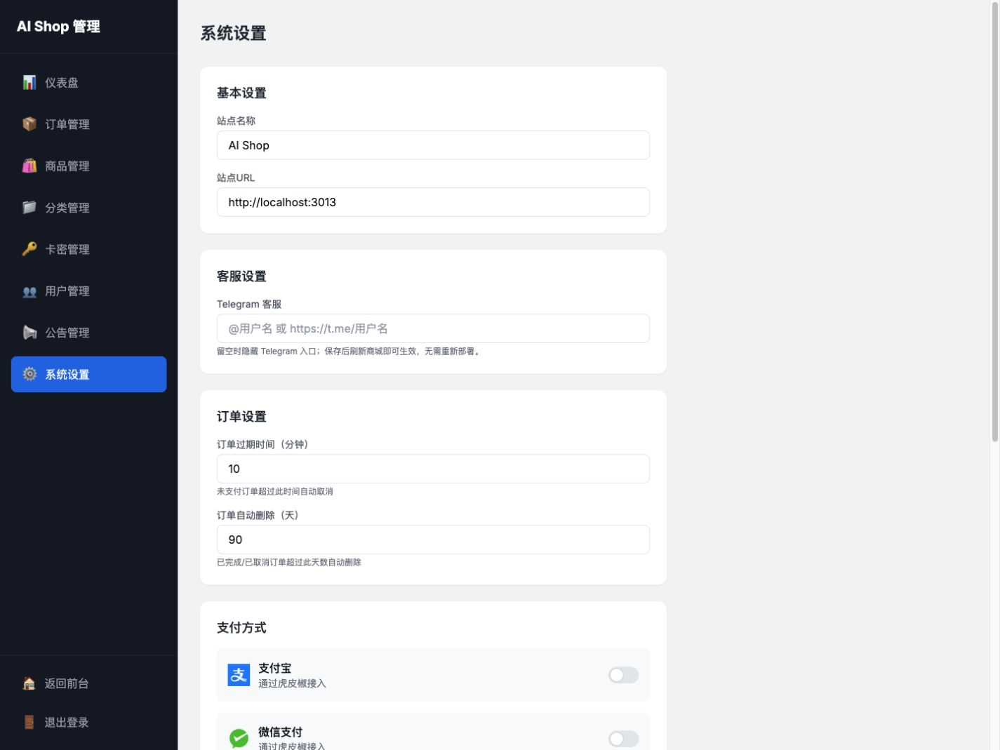

</details>

## Features

### Customer experience

- **Direct purchases:** choose a quantity on the product page, enter an email address, and set an order lookup password. Guest purchases are supported; there is no shopping cart.
- **Automatic delivery:** view, copy, or download delivered keys from the order details. Members can pay with their account balance and receive membership discounts.
- **Email and order number lookup:** complete slider verification to open a separate order list with status filters and pagination. Viewing an order's details requires its lookup password.
- **Recent email history:** successful searches save up to three recent email addresses in the current browser. Click an address to fill the field or remove it; order numbers are not saved.
- **Member center:** view account details, recent orders, and balance history. Navigation stays visible when switching between the dashboard, orders, and balance pages.
- **Smart support:** use the site-wide assistant for purchase, product, stock, payment, order, and after-sales questions; escalate to configured WeChat or Telegram support when needed.
- **Mobile layouts:** responsive product pages, order cards, navigation, and touch support for slider verification.

Purchase flow: **Choose a product → Enter email and lookup password → Pay → Automatic delivery → View order details**.

### Administration and operations

- **Dashboard:** order and revenue statistics, user counts, pending orders, and low-stock alerts.
- **Products and categories:** product descriptions, cover images, prices, quantity limits, sorting, and listing status.
- **Digital key inventory:** batch imports, batch identifiers, and paginated unsold inventory by status. Reveal, edit, or delete individual unallocated keys; reserved and sold keys cannot be changed. Keys are encrypted and reserved when orders are created.
- **Orders and users:** view order details and membership levels; manage delivery, cancellation, refunds, account status, and balances. Membership levels upgrade automatically based on total spending.
- **Announcements and settings:** announcements, site information, order expiry, and payment switches, with a separate Support & community page for WeChat support, Telegram links, and group QR codes.
- **Permanent community entry:** the homepage and README share a join page; admins replace the group QR code and optionally set an expiry time. Expired codes are hidden.
- **Admin roles:** OPERATOR handles products and delivery; ADMIN manages users and finances; SUPER_ADMIN manages system settings and Support & community configuration.
- **Admin navigation:** management pages share a persistent sidebar; transitions load only the content area, with loading placeholders, progress indicators, and retry support.
- **Smart support administration:** edit and publish support knowledge, configure the shop's dedicated sub2api model, and inspect input, output, cache, reasoning-token, and estimated-cost metrics.

### Payments and notifications

Supported payment methods are Alipay and WeChat Pay through XunhuPay, USDT TRC20, and member account balances. External payment methods require configured credentials and an enabled channel. Automatic ERC20 collection is not available.

Email addresses are used for order lookup and optional notifications. Email and Telegram notifications require separate configuration; customers can still retrieve keys from order details without them. Balance refunds return funds to the customer's account balance. External refunds must be processed manually through the payment provider before being recorded in the admin panel.

### Order and data protection

Orders use cryptographically random identifiers. Lookup passwords are hashed, and digital keys are encrypted with AES-256-GCM. Public lookup shows order summaries first and requires password verification before accessing delivery details. Signed-in members can only access their own orders; balance top-up orders always require the owner's login. Database transactions protect balance changes, inventory, and fulfillment. Duplicate payment callbacks do not credit accounts twice.

See [Security and usage boundaries](docs/security.md) (Chinese) for order privacy, account permissions, and deployment requirements.

## Requirements

- Node.js 22.14+; Node.js 22 LTS is recommended.
- PostgreSQL 15+ and Redis 7+; both are required.
- Docker Compose 2.24.4+; the local override file uses `!override`.

## Configuration

Edit **`.env` for local development**, and **`.deploy/production.env` for production**.
Test credentials are automatically managed by `npm run env:init`; do not copy production credentials into tests.
`.env.example` is a template, not an active configuration. Run `npm run env:status` to see configuration locations and presence without printing secrets.
Production changes take effect only after an explicitly authorized deployment. See [Configuration](CONFIGURATION.md).

## Isolated development and releases

Development never uses the production configuration or data. The default Compose project is `ai-shop-dev`; production is a separate `ai-shop` project with private configuration under ignored `.deploy/`.

```bash
npm ci
npm run env:init
npm run dev:up
npm run db:generate
npm run db:prepare
npm run db:seed
npm run dev
```

- Local development and manual acceptance: http://127.0.0.1:3013; PostgreSQL 55440 and Redis 16380, loopback only.
- Acceptance: independent `ai-shop-test` services (55441 / 16381), HTTP tests on 3011, temporary image checks on 3014 (stopped after checks).
- Production: the existing public domain through loopback port 3010. Development and testing do not rebuild or restart it.
- The development `admin` password is generated in `.env`. No production data, credentials, payment, email or AI keys are copied into local environments.

```bash
npm run test:up
npm run release:prepare
```

This runs acceptance, builds an immutable image and checks it in the isolated preview. A failed gate blocks promotion. It does **not** deploy to production. After reviewing the release ID and explicitly authorizing production deployment:

```bash
npm run release:deploy -- <release-id> --confirm-production
```

Production deployment backs up the database, explicitly applies migrations, replaces only the app image and reloads Nginx. It never runs demo seed or recreates PostgreSQL/Redis. Runtime startup no longer automatically migrates. See the [environment and release guide](docs/operations/environments.md) for configuration, rollback, and first-time adoption. Existing production settings are saved in `.deploy/production.env`; do not copy them back into `.env`.

| Integration | Configuration |
|---|---|
| Alipay | `XUNHU_ALIPAY_APPID`, `XUNHU_ALIPAY_APPSECRET` |
| WeChat Pay | `XUNHU_WECHAT_APPID`, `XUNHU_WECHAT_APPSECRET` |
| USDT TRC20 | `USDT_TRC20_ADDRESS`, optional `TRONGRID_API_KEY` |
| System email (password resets and payment notifications) | `SMTP_HOST`, `SMTP_PORT`, `SMTP_USER`, `SMTP_PASS`, `MAIL_FROM` |
| Telegram notifications | `TELEGRAM_BOT_TOKEN`, `TELEGRAM_CHAT_ID` |
| Image uploads | `CLOUDINARY_CLOUD_NAME`, `CLOUDINARY_API_KEY`, `CLOUDINARY_API_SECRET` |
| WeChat support | Admin panel → Support & community → WeChat support; upload a support QR image. The storefront dialog shows only the QR image and scanning instructions. |
| Telegram support link | Admin panel → Support & community → Telegram support; leave blank to hide. |
| WeChat community | Admin panel → Support & community → WeChat community; upload the current group QR code and optionally set its expiry. |
| Smart support model | `SUPPORT_LLM_BASE_URL`, a shop-specific `SUPPORT_LLM_API_KEY`, and `SUPPORT_LLM_MODEL`; see the [Smart support technical document](docs/ai-support.md). |
| External scheduled calls | `CRON_SECRET`; send `Authorization: Bearer ...`. |
| Pending inventory quotas | `MAX_PENDING_ORDERS=3`, `MAX_PENDING_QUANTITY=100`, enforced separately per account, email, and trusted client IP. |

Local development and manual acceptance share `.env`, the database, accounts, and port 3013. Stop `npm run dev` before `npm run release:prepare`; after all gates pass, the accepted image replaces the local server without resetting data. Automated tests remain isolated. For real model testing on port 3013, configure a dedicated support API key, gateway and budget in `.env`; automated tests continue to reject external model credentials.

## Verification and maintenance

Before updating a deployed instance, back up the database and `.deploy/production.env` and preserve the digital-key encryption key.

CI covers production builds, isolated tests, HTTP checks, and security scans. See [Contributing](CONTRIBUTING.md) (Chinese) for the full validation commands and [dependency maintenance](docs/security.md#验证与依赖维护) (Chinese) for known advisories and temporary patches.

- [Support and community maintenance](docs/community/README.md#english)
- [Security policy and private vulnerability reports](SECURITY.md) (Chinese)
- [Contributing](CONTRIBUTING.md) (Chinese)
- [Third-party notices](THIRD_PARTY_NOTICES.md)
- [MIT License](LICENSE)

## License

Project code is licensed under MIT. Product and brand names describe demo content and compatible services; they do not imply authorization to resell third-party accounts. Operators are responsible for payment integration testing, data protection, and rights to the products they offer.
